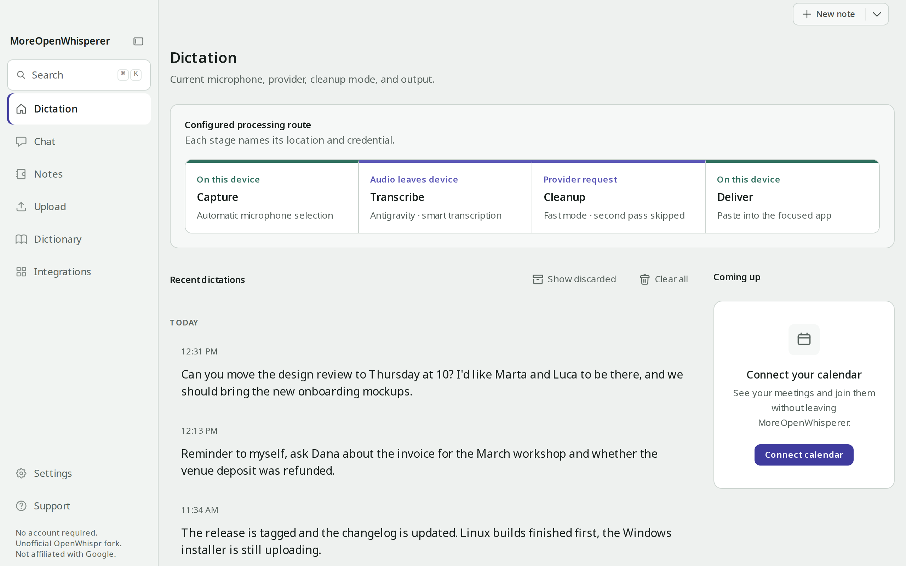
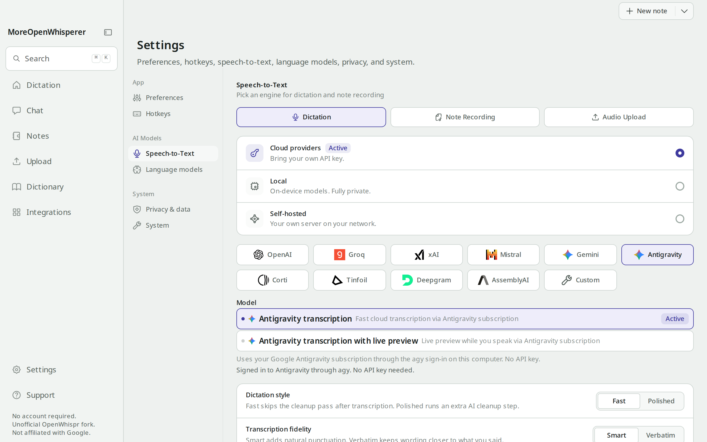
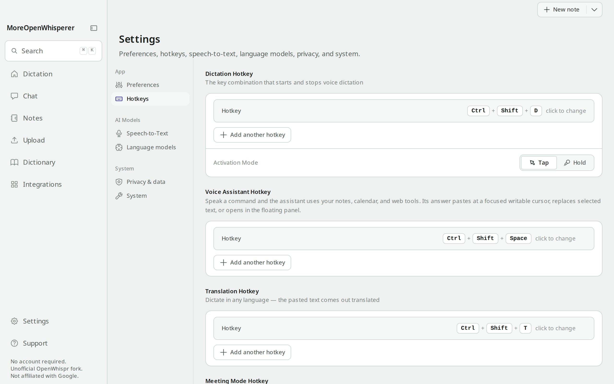

<p align="center">
  
</p>

<h1 align="center">MoreOpenWhisperer</h1>

<p align="center">
  Press a hotkey, speak, and the text lands at your cursor.<br>
  An unofficial <a href="https://github.com/OpenWhispr/openwhispr">OpenWhispr</a> fork that transcribes with Antigravity, your own API keys or local models. There is no OpenWhispr Cloud account.
</p>

<p align="center">
  <a href="https://github.com/SuperTost100/moreopenwhisperer/releases/latest"></a>
  <a href="https://github.com/SuperTost100/moreopenwhisperer/actions/workflows/build-and-notarize.yml"></a>
  <a href="LICENSE"></a>
</p>

<p align="center">
  <a href="#install">Install</a> ·
  <a href="#documentation">Documentation</a> ·
  <a href=".github/CONTRIBUTING.md">Contributing</a> ·
  <a href="SECURITY.md">Security</a>
</p>

<picture>
  <source media="(prefers-color-scheme: dark)" srcset="docs/screenshots/dictation-dark.png">
  
</picture>

## Why MoreOpenWhisperer

MoreOpenWhisperer is the OpenWhispr desktop app with the SaaS layer cut out. Dictation, meetings, notes, calendars and the voice assistant stay. OpenWhispr Cloud sign-in, Pro upsells, hosted MCP and telemetry are gone.

There is no account, no subscription and no server of this project. Transcription defaults to your [Antigravity](docs/antigravity.md) subscription (`agy`). You can point it at Whisper, Parakeet, Cohere or a provider key you already pay for instead. The provider you pick may charge for usage. MoreOpenWhisperer doesn't.

It is not OpenWhispr, not Gizmo Labs and not Google. It is MIT licensed, like upstream. It runs on macOS, Windows and Linux.

## What it does

**Dictate anywhere.** Press the global hotkey, speak, and the text pastes into the focused app. The default is Globe/Fn on a Mac and Control+Super on Windows and Linux, with fallbacks if the OS already owns that combination.

**Use Antigravity for transcription and cleanup.** Sign in once with `agy auth login`. Fast dictation goes through Google's Cloud Code gateway, with an optional live preview. Cleanup, the agent and chat can use the same session. [Setup](docs/antigravity.md).

**Bring your own keys.** OpenAI, Anthropic, Gemini, Groq, OpenRouter, Azure, Bedrock, Tinfoil and Mistral work. Keys stay in the OS keychain.

**Run fully local.** whisper.cpp (Metal, CUDA or Vulkan), NVIDIA Parakeet, Cohere Transcribe and local GGUF models through llama.cpp. On this path audio never leaves the machine.

**Record meetings.** The app detects Zoom, Teams, FaceTime and the rest, then records your mic plus system audio with speaker labels. Calendars link up with Google, Microsoft and Apple (on macOS).

**Keep notes.** Notes live in local folders. Semantic search works when Qdrant is running, and AI actions run on a note. There is no cloud sync, because there is no cloud account.

**Ask the voice assistant.** It has its own hotkey and no wake word. Answers paste at a verified caret or open in the floating panel. A separate translation hotkey lets you dictate in one language and paste in another.

**Script it locally.** `openwhispr --local …` talks to the running app on 127.0.0.1. Cloud CLI login is gone.

<table>
  <tr>
    <td width="50%">
      <picture>
        <source media="(prefers-color-scheme: dark)" srcset="docs/screenshots/speech-to-text-dark.png">
        
      </picture>
    </td>
    <td width="50%">
      <picture>
        <source media="(prefers-color-scheme: dark)" srcset="docs/screenshots/hotkeys-dark.png">
        
      </picture>
    </td>
  </tr>
  <tr>
    <td>Pick Antigravity, a provider key, a local model or your own server.</td>
    <td>Separate hotkeys for dictation, the voice assistant, translation and meetings.</td>
  </tr>
</table>

### What this fork drops

These features sit behind Cloud or Pro in [official OpenWhispr](https://github.com/OpenWhispr/openwhispr). They are removed here on purpose:

- OpenWhispr Cloud transcription and sign-in
- Hosted MCP (`mcp.openwhispr.com`)
- `openwhispr auth login` and the rest of the cloud CLI
- Account, billing, workspace, referrals, usage analytics and team spaces
- Telemetry (the toggle is gone and it stays off)

|                 | MoreOpenWhisperer        | OpenWhispr                  |
| --------------- | ------------------------ | --------------------------- |
| Cloud account   | Removed                  | Optional free + Pro         |
| STT / LLM       | Antigravity, BYOK, local | Those plus OpenWhispr Cloud |
| MCP / cloud CLI | Removed                  | Pro                         |
| Telemetry       | Off                      | Opt-in toggle               |
| Platforms       | macOS, Windows, Linux    | macOS, Windows, Linux       |

The upstream README is kept as [README.upstream.md](README.upstream.md).

## Install

Download the file for your system from the [latest release](https://github.com/SuperTost100/moreopenwhisperer/releases/latest). The `.zip` files and `latest*.yml` files in the release are for the in-app updater, so you don't need them.

| System                         | File                                                |
| ------------------------------ | --------------------------------------------------- |
| macOS, Apple Silicon           | `MoreOpenWhisperer-<version>-arm64.dmg`             |
| macOS, Intel \*                | `MoreOpenWhisperer-<version>.dmg`                   |
| Windows x64                    | `MoreOpenWhisperer-Setup-<version>.exe`             |
| Linux x64, Debian and Ubuntu   | `MoreOpenWhisperer-<version>-linux-amd64.deb`       |
| Linux x64, Fedora and openSUSE | `MoreOpenWhisperer-<version>-linux-x86_64.rpm`      |
| Linux x64, any distribution    | `MoreOpenWhisperer-<version>-linux-x86_64.AppImage` |
| Linux x64, manual unpack       | `MoreOpenWhisperer-<version>-linux-x64.tar.gz`      |

\* On Intel Macs, live speaker identification and voice fingerprinting are unavailable. ONNX Runtime [stopped shipping macOS x86_64 binaries in 1.24](https://github.com/microsoft/onnxruntime/releases/tag/v1.24.1). Meetings still record and transcribe, and notes search falls back to keyword matching.

The builds aren't signed with a paid certificate, so your OS warns you the first time. A warning on an unsigned download doesn't mean the file is broken.

- **macOS.** Open the DMG and drag MoreOpenWhisperer to Applications. Right-click the app and choose Open, or use Open Anyway in System Settings → Privacy & Security. If macOS says the app is damaged, that is Gatekeeper on an unsigned download. Run `xattr -cr /Applications/MoreOpenWhisperer.app` and open it again. [More on macOS](docs/macos.md).
- **Windows.** Run the installer. If SmartScreen says "Windows protected your PC", choose More info → Run anyway. Defender sometimes quarantines the bundled whisper.cpp or FFmpeg, so add the install folder to its exclusions if transcription dies at once. [More on Windows](docs/windows.md).
- **Linux.** Install the `.deb` with `sudo apt install ./<file>.deb`, the `.rpm` with `sudo dnf install ./<file>.rpm`, or run `chmod +x` on the AppImage and start it. Wayland needs extra setup for hotkeys and paste. [More on Linux](docs/linux.md).

The in-app updater checks GitHub releases three seconds after launch and every four hours on macOS, Windows and the AppImage. For new installs it downloads updates on its own. If you turn that off, the sidebar offers a manual download. Unsigned macOS builds get no notarized update, so download the next `.dmg` from Releases. The `.deb`, `.rpm` and `.tar.gz` installs don't self-update. Install the new package yourself.

### First launch

The onboarding flow asks for the system permissions the app needs. That is the microphone on macOS and Windows, plus Accessibility (auto-paste) and System Audio (meetings) on macOS. Linux has no app-level permission prompts. Then you choose your language and hotkey, try a dictation demo, and pick how to transcribe: Antigravity, your own API key or a local model. For Antigravity, install `agy` and run `agy auth login` first.

## Your data

Settings, logs and keys live in the app's data folder, and local models in a cache folder.

| System  | Settings, logs, keys                           | Local models                       |
| ------- | ---------------------------------------------- | ---------------------------------- |
| macOS   | `~/Library/Application Support/MoreOpenWhispr` | `~/.cache/openwhispr/`             |
| Windows | `%APPDATA%\MoreOpenWhispr`                     | `%USERPROFILE%\.cache\openwhispr\` |
| Linux   | `~/.config/MoreOpenWhispr`                     | `~/.cache/openwhispr/`             |

These actions send data off your computer, and only when you use the feature:

- **Antigravity.** Audio or text goes to Google's Cloud Code endpoints with your own `agy` sign-in. Google's terms apply. This repo is client software, not a Google product, and not unlimited free Google transcription.
- **Provider keys.** Audio or text goes to the provider whose key you saved. Its retention and billing rules apply.
- **Calendars.** Connecting Google or Microsoft contacts their OAuth and calendar APIs. Apple Calendar on macOS stays local.
- **URL import.** Pasting a link in Upload fetches that page, and YouTube links go through the bundled yt-dlp.
- **Downloads.** Local models come from Hugging Face, and runtime binaries from GitHub, after you opt in.
- **Updates.** The updater asks GitHub for the latest release. It sends no dictation or note content.

Whisper, Parakeet and the other local models keep audio on the device. Provider keys sit in the OS keychain. On Linux without a keyring they fall back to plaintext, as [SECURITY.md](SECURITY.md) explains. The app has no telemetry. [docs/network-allowlist.md](docs/network-allowlist.md) lists every host it can contact.

## Build from source

You need [Node.js 24](https://nodejs.org/), pinned in `.nvmrc`. Don't regenerate `package-lock.json` with another major.

```bash
git clone https://github.com/SuperTost100/moreopenwhisperer.git
cd moreopenwhisperer
nvm use
npm ci          # installs dependencies and rebuilds the native addons for your machine
npm run dev     # compiles platform helpers, downloads sidecar binaries on first run, starts Electron and Vite
```

The checks CI runs:

```bash
npm run lint
npm run typecheck
npm test
npm run i18n:check
```

Packaged installers come from `npm run build:mac`, `npm run build:win` or `npm run build:linux`. They are unsigned. [docs/building.md](docs/building.md) has the full matrix and the native helpers. Tagging `v*` makes GitHub Actions pack all four platforms.

These commands run the desktop app at the repository root. The Expo mobile app lives in [`openwhispr-mobile`](openwhispr-mobile/README.md) with its own dependencies, lockfile and release process.

The stack is React 19, TypeScript, Tailwind CSS v4, Electron 41, better-sqlite3, whisper.cpp, sherpa-onnx, llama.cpp and shadcn/ui. [CONTRIBUTING.md](.github/CONTRIBUTING.md) covers how to file issues and pull requests. `main` is the shipping branch. Fixes that belong in official OpenWhispr go to [OpenWhispr/openwhispr](https://github.com/OpenWhispr/openwhispr).

## Documentation

| Read this                                      | To learn                                                 |
| ---------------------------------------------- | -------------------------------------------------------- |
| [macOS](docs/macos.md)                         | Globe key, Gatekeeper, permissions                       |
| [Windows](docs/windows.md)                     | Installer, SmartScreen, push-to-talk                     |
| [Linux](docs/linux.md)                         | AppImage, deb, rpm, Wayland hotkeys and paste            |
| [Building](docs/building.md)                   | Every platform, from a git checkout                      |
| [Antigravity](docs/antigravity.md)             | `agy` login, Fast vs Polished, what Google sees          |
| [Local Whisper](LOCAL_WHISPER_SETUP.md)        | Models, GPU packs, cache paths                           |
| [Network allowlist](docs/network-allowlist.md) | Firewall and proxy hosts                                 |
| [Troubleshooting](TROUBLESHOOTING.md)          | Common failures and fixes                                |
| [Debug logs](DEBUG.md)                         | What to attach to a bug report                           |
| [Security](SECURITY.md)                        | Reporting a vulnerability and the security model         |
| [Changelog](CHANGELOG.md)                      | What changed in each release                             |
| [Custom ASR shim](examples/custom-asr-shim/)   | Self-hosted transcription against non-OpenAI-shaped APIs |

## License

[MIT](LICENSE), the same grant as upstream. The copyright line stays with the OpenWhispr Team, so keep that file with any binary you ship.

MoreOpenWhisperer builds on [OpenWhispr](https://github.com/OpenWhispr/openwhispr), [OpenAI Whisper](https://github.com/openai/whisper) and [whisper.cpp](https://github.com/ggerganov/whisper.cpp), [NVIDIA Parakeet](https://huggingface.co/nvidia/parakeet-tdt-0.6b-v3) and [sherpa-onnx](https://github.com/k2-fsa/sherpa-onnx), [llama.cpp](https://github.com/ggerganov/llama.cpp), [Electron](https://www.electronjs.org/), [React](https://react.dev/) and [shadcn/ui](https://ui.shadcn.com/).
